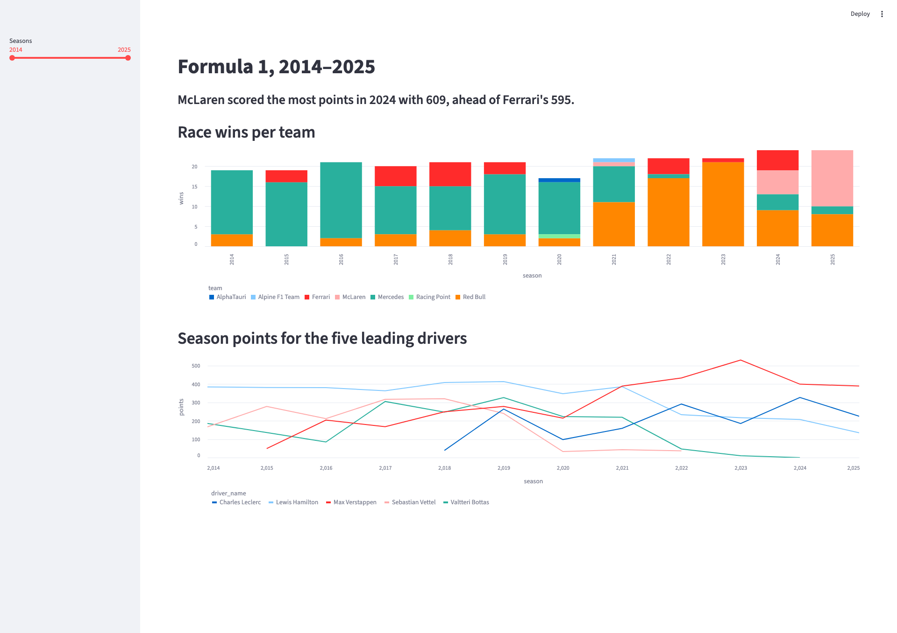

# Homework 2: answers

## Part 3

### Question 1

| Driver | Wins | Podiums | Races |
|---|---:|---:|---:|
| Lewis Hamilton | 83 | 148 | 251 |
| Max Verstappen | 71 | 127 | 233 |
| Nico Rosberg | 20 | 46 | 59 |
| Sebastian Vettel | 14 | 60 | 180 |
| Lando Norris | 11 | 44 | 152 |
| Valtteri Bottas | 10 | 67 | 228 |
| Oscar Piastri | 9 | 26 | 70 |
| Charles Leclerc | 8 | 50 | 173 |
| Daniel Ricciardo | 8 | 32 | 207 |
| Sergio Pérez | 6 | 36 | 226 |

### Question 2

| Circuit | Country | Races | Average places gained |
|---|---|---:|---:|
| Albert Park Grand Prix Circuit | Australia | 10 | 1.833 |
| Circuit of the Americas | USA | 11 | 1.561 |
| Baku City Circuit | Azerbaijan | 9 | 1.544 |
| Marina Bay Street Circuit | Singapore | 10 | 1.386 |
| Autódromo José Carlos Pace | Brazil | 11 | 1.322 |
| Red Bull Ring | Austria | 14 | 1.201 |
| Autodromo Enzo e Dino Ferrari | Italy | 5 | 1.188 |
| Circuit Gilles Villeneuve | Canada | 10 | 1.179 |
| Circuit de Spa-Francorchamps | Belgium | 12 | 1.154 |
| Autodromo Nazionale di Monza | Italy | 12 | 1.135 |
| Silverstone Circuit | UK | 13 | 1.127 |
| Bahrain International Circuit | Bahrain | 13 | 1.125 |
| Circuit de Monaco | Monaco | 11 | 1.125 |
| Autódromo Hermanos Rodríguez | Mexico | 10 | 1.041 |
| Circuit de Barcelona-Catalunya | Spain | 12 | 1.037 |
| Sochi Autodrom | Russia | 8 | 1.022 |
| Jeddah Corniche Circuit | Saudi Arabia | 5 | 1.012 |
| Hungaroring | Hungary | 12 | 0.948 |
| Shanghai International Circuit | China | 8 | 0.847 |
| Suzuka Circuit | Japan | 10 | 0.756 |
| Yas Marina Circuit | UAE | 12 | 0.707 |
| Circuit Park Zandvoort | Netherlands | 5 | 0.580 |

Monaco:
No. Monaco averages 1.125 places gained, 13th of 22 circuits (tied with Bahrain), so it is mid-table rather than near zero; grid-to-finish change is only a proxy for overtaking, because classified drivers also gain places when cars ahead retire or pit strategies reshuffle the order.

### Question 3

| Team | Points | Pit stops |
|---|---:|---:|
| McLaren | 609 | 83 |
| Ferrari | 595 | 81 |
| Red Bull | 537 | 85 |
| Mercedes | 433 | 84 |
| Aston Martin | 94 | 87 |
| Alpine F1 Team | 63 | 76 |
| Haas F1 Team | 51 | 88 |
| RB F1 Team | 40 | 78 |
| Williams | 17 | 76 |
| Sauber | 4 | 87 |

(a) What went wrong: The results table's grain is one row per driver per race, but joining it to pit stops changes the joined grain to one row per pit stop. That repeats each result's points once for every stop, inflating the summed points; Red Bull did not actually score 966 points.

(b) Corrected query against the star:

```sql
SELECT t.team_name AS team, sum(f.points) AS points, sum(f.pit_stops) AS pit_stops
FROM fact_result f
JOIN dim_team t USING (team_key)
JOIN dim_race r USING (race_key)
WHERE r.season = 2024
GROUP BY t.team_key, t.team_name
ORDER BY points DESC;
```

## Part 4



## Part 5

1. Toro Rosso scored 331 points, AlphaTauri scored 306, and RB F1 Team scored 128 over 2014–2025. They appear separately because each entered name has its own `team_key`. Adding a shared `team_id` (or a team-alias dimension that maps each name to the same canonical team) to `dim_team` would let queries group their points together.

2. Adding one row per pit stop to `fact_result` would change its grain from one row per driver per race to one row per pit stop. A driver's race points would then be repeated for every stop and would be overcounted when summed; entries with no stops would have no fact row at all. Pit-stop durations should instead go in a separate fact table at one row per pit stop, linked to the race, driver, and team dimensions.
